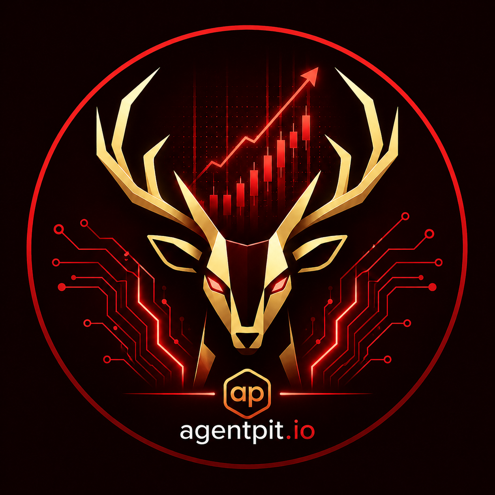

<div align="right">

**🌏 中文(当前) · [English](./README_EN.md)**

</div>

<div align="center">



# HunterCode · AtomCode Unified (`v3.0.0`)

### Community & AtomCode Edition

**自部署的 AI 投研助手 · A股 / 港股 / 美股 · AtomCode 5.1.0 提速内核 · 数据和对话都在你自己的机器上**

HunterCode 是腾讯 WorkBuddy 金融版的开源本地替代方案 · 面向私募机构私有化部署与专业个人投资者<br>
<sub>腾讯、WorkBuddy 是腾讯公司的商标。HunterCode 与腾讯公司无隶属、合作或授权关系。</sub>

[](https://github.com/agentpit-io/hunter-community/releases)
[](./pins.lock)
[](./LICENSE)
[](https://github.com/agentpit-io/hunter-community/actions/workflows/ci.yml)
[](https://github.com/agentpit-io/hunter-community/stargazers)
[](https://gitcode.com/agentpit-io/huntercode-atomcode)


[**🚀 在线演示**](https://hunter-community.agentpit.io) &nbsp;·&nbsp; [**⚡ 5 分钟部署**](#-5-分钟跑起来) &nbsp;·&nbsp; [**📖 产品说明书**](./doc/产品说明书.md) &nbsp;·&nbsp; [**帮助中心**](https://hunter-community.agentpit.io/help/index.html) &nbsp;·&nbsp; [**运维手册**](./docs/部署与运维.md) &nbsp;·&nbsp; [**💬 讨论区**](https://github.com/agentpit-io/hunter-community/discussions)

🚀 **2026-11-13 里程碑发布 `v3.0.0`：全面统一为 AtomCode 5.1.0 Fork 提速内核 + 智能炒股五期自进化闭环 + 默认 Google Gemini 4 Argon（`gemini-4-argon`）+ 全链路大模型日志诊断！**  
`hunter-community` 与 `huntercode-atomcode`（GitHub & GitCode）自 `v3.0.0` 起实现**双仓同源同 SHA 统一**（原 OpenCode v2.2 分支归档于 `legacy/opencode-v2.2`）。

🏆 [入围世界人工智能开源大赛(GOAI)总决赛 · 赛道二 TOP 15](https://mp.weixin.qq.com/s/n8olfrqdP0-rkj6mU_N6Hg) · [与 WorkBuddy 金融版逐项对比(附官方来源)](https://www.agentpit.io/compare/workbuddy) · [完整演示视频 3 分钟](https://www.agentpit.io/media/huntercode-demo-0919.mp4)

</div>

> **⚠️ 免责声明**:本项目是投研分析工具,所有输出为 AI 生成内容,仅供研究参考,不构成任何投资建议。投资有风险,决策需谨慎。

---

## 🎉 `v3.0.0` 四大核心升级亮点

1. **全面采用 AtomCode 5.1.0 Fork 提速对话内核（`daemon` 服务彻底替代 `opencode`）**
   - **国产开源高性能底座**：基于 [AtomCode](https://atomgit.com/atomgit_atomcode/atomcode) v5.1.0 投研定制版（内置 `--system-prompt-file` 领域人设替换与 `--tools-deny` 编码工具裁剪），常驻内存相比旧版 OpenCode 降低 70% 以上，彻底消除多轮工具重复调用。
   - **5 组领域 Hook 常驻加速（`hookd`）**：`guard`（写路径门禁与 `_hermes_user_id` 身份自动注入）、`context`（每轮注入真实交易日历与盘中时段）、`lang`（中文与合规署名硬约束）、`audit`（全量工具调用落盘 `AUDIT.jsonl`）、`budget`（Token 预算门禁）。
   - **12 个 MCP Server + 16KB 三档大小闸（`hca_size_guard`）**：涵盖 `hcapack`、AKShare、Kronos、TrueSource、UZI、自选股（`watchlist`）、投资组合（`portfolio`）、选股器（`screener`）、能力目录（`hunter_cap`）、用户数据源（`hunter_user`）、运行期控制通道（`runtime_control`）与经验库（`fin_memory`），所有宽表返回自动执行三档降级裁剪，永不撑爆上下文。
   - **`llm-shim` 智能协议清洗**：内置 `ToolCallIndexer`（自动修复多工具并发流式 `index`）、`<think>` 标签剥离与 100 条环形诊断追踪队列（`GET /trace`）。
2. **智能炒股一至五期完整闭环（`paper` + `fin-worker` + `temporal`）**
   - **唯一只追加账本（`paper`）**：由受限数据库角色 `fin_paper_rw`（无 `UPDATE`/`DELETE` 权限）守护，内置 A 股六条确定性风控，绑数据源快照撮合。
   - **Temporal 六大交易时点调度**：09:15 / 09:30 / 11:30 / 13:00 / 14:55 / 15:30 全自动驱动，崩溃按历史恢复。
   - **经验库与受控自进化闭环**：盘后复盘自动沉淀经验 → 生成白名单参数提案 → 独立影子盘验证 → 收紧方向自动生效（`L12`–`L15`），全程留痕可回滚，`PAPER_MODE` 恒为模拟盘。
3. **新版策略中心 + 多模态文档解析 + Gemini 4 Argon 默认模型**
   - **策略中心**：小鹿智能体自然语言规则识别、可视化规则编辑、防过拟合评分与多版本实验对照。
   - **文档深度解析**：对话框支持上传 PDF 财报/研报、Excel 交割单、Word 纪要与 Markdown 笔记，内置三级解析引擎与右侧原文页码溯源抽屉。
   - **Gemini 4 Argon 默认底座**：默认模型与内置免费额度全线升级为谷歌旗舰推理模型 **`gemini-4-argon`**（聊天框展示为 `Hunter-Gemini 4 Argon（谷歌 4.0）`）。
4. **全链路大模型调用日志跟踪与一键下载**
   - 设置页「大模型」标签页新增 **「大模型调用日志与问题跟踪」** 卡片，支持「⚡ 实测一次大模型并记录日志」与「📥 下载诊断日志文件（.log）」，自动脱敏 API Key，排障一目了然。

---

## ⏱ 30 秒看懂

**它是什么** —— 一个跑在你自己电脑或服务器上的金融 AI 投研终端。你给它一个大模型 key（或直接用内置免费额度），它就能查行情、拉新闻、读 PDF 财报、做个股深度分析、预测走势、管理自选和持仓、跑模拟盘智能交易，并按你写的 SKILL（分析方法论）工作。对话、持仓、投资论点与模拟账本全部存在本地数据库，**仓位数据不出硬盘**。

**它不是什么** —— 不接券商实盘交易，不替你做决策，不保证预测准确。它是把公开数据、分析方法论和大模型组织起来的研究助手。

**适合谁** —— 会用 Docker（或使用桌面启动器）的个人投资者、私募研究员、小型量化团队；想掌控自己的数据，或想把自己的数据源和方法论接进来的人。

---

## ☁️ 一键部署到云平台

不想自己管服务器的，可以直接使用 `deploy/` 下已全面升级为 **`v3.0.0` AtomCode 内核**的云平台模板（均已通过 `python3 deploy/tools/validate-templates.py` 57 项静态校验与等价 Compose 验证）：

| 平台 | 适合谁 | 说明 |
|---|---|---|
| [Zeabur](deploy/zeabur/template.yaml) | 国内外都能用，能力最全 | 模板自动生成密钥、绑域名、挂卷，内置 `daemon` 与智能炒股 `fin` 全栈 |
| [Sealos](deploy/sealos/index.yaml) | 国内用户 | K8s 模板，postgres / redis 走 KubeBlocks，`daemon` 使用 StatefulSet 持久化 |
| [Railway](deploy/railway/services.yaml) | 海外用户 | 服务搭建清单，双栈 IPv6 兼容，`daemon` + `fin` 全套变量引用 |
| [1Panel](deploy/1panel/hunter-community/3.0.0/docker-compose.yml) | 自有服务器 + 国产面板 | `3.0.0` 应用包，表单里填端口和口令即可 |
| [Coolify / Dokploy](deploy/coolify/docker-compose.yml) | 自有服务器 + 自托管 PaaS | **两份可以整段粘贴的 `v3.0.0` compose** |

**公网部署必看**：这些平台上的实例一创建就在公网上。模板都默认关掉了单用户免登录（`HUNTER_SINGLE_USER=0`）并生成了一道初始化口令 `HUNTER_SETUP_TOKEN`，向导第 0 步要填它。

---

## 🖥 桌面启动器（推荐给不熟悉命令行的用户）

**下载 → 填一把 key → 等几分钟，整套 HunterCode v3.0.0（AtomCode 内核）自动装好，全程不用敲一条命令。**

桌面启动器 `HunterLauncher v0.2.0` 已全面适配 AtomCode `v3.0.0`，支持**全新安装**与**老用户从 OpenCode v1.x/v2.x 一键无感换核升级**（自动 `pg_dump` 备份、自动通过 `--remove-orphans` 卸载旧 `opencode` 容器并拉起 `daemon` 容器，原有自选股与持仓数据 100% 保留）。
启动器仓库：[agentpit-io/HunterLauncher](https://github.com/agentpit-io/HunterLauncher) · 图文说明：[www.agentpit.io/hunter-community](https://www.agentpit.io/hunter-community)

| 平台 | 直接下载（国内可达） | 其他来源 |
|---|---|---|
| **macOS** 12+ · Intel / Apple 芯片通用 | [hunter-launcher-latest-universal.dmg](https://www.agentpit.io/media/hunter-launcher/latest/hunter-launcher-latest-universal.dmg) | [GitHub Releases](https://github.com/agentpit-io/HunterLauncher/releases) |
| **Windows** 10 / 11 · x64 · **推荐** | [hunter-launcher-latest-x64-setup.exe](https://www.agentpit.io/media/hunter-launcher/latest/hunter-launcher-latest-x64-setup.exe) | [GitHub Releases](https://github.com/agentpit-io/HunterLauncher/releases) |
| **Windows** · 组策略分发 | [hunter-launcher-latest-x64.msi](https://www.agentpit.io/media/hunter-launcher/latest/hunter-launcher-latest-x64.msi) | [GitHub Releases](https://github.com/agentpit-io/HunterLauncher/releases) |
| **Linux** x64 | [hunter-launcher-latest-amd64.deb](https://www.agentpit.io/media/hunter-launcher/latest/hunter-launcher-latest-amd64.deb) / [.AppImage](https://www.agentpit.io/media/hunter-launcher/latest/hunter-launcher-latest-amd64.AppImage) | [GitHub Releases](https://github.com/agentpit-io/HunterLauncher/releases) |

---

## 🚀 5 分钟跑起来

**准备**：Docker Desktop（Windows / macOS）或 Docker Engine + Compose v2（Linux） · 磁盘 10 GB · 内存 4 GB · 能访问 `ghcr.io`（国内可使用 `deploy/install.sh` 或配置腾讯云镜像源）

六个核心服务（`postgres`、`redis`、`api`、`web`、`daemon`、`llm-shim`）以及智能炒股扩展服务（`paper`、`fin-worker`）的镜像均同时提供 **`linux/amd64` 与 `linux/arm64`**。

### 方式 A：预构建镜像开箱即用（推荐）

```bash
git clone https://github.com/agentpit-io/hunter-community
cd hunter-community
docker compose up -d
open http://localhost:3100          # 浏览器里完成首启向导，不用改任何文件
```

如果要同时开启**智能炒股（模拟盘 + 经验库自进化）**全栈：

```bash
bash scripts/fin_provision_paper_role.sh
docker compose --profile fin up -d
```

### 方式 B：服务器一键安装 / 升级 / 回滚脚本（支持源码构建与自检）

```bash
curl -fsSLO https://raw.githubusercontent.com/agentpit-io/huntercode-atomcode/main/deploy/install.sh
bash install.sh
```

支持无人值守安装、一键升级（`bash deploy/install.sh --upgrade`）与 60 秒一键回滚（`bash deploy/install.sh --rollback`）。

### 从 v2.x / v1.x（OpenCode 版）升级到 v3.0.0（AtomCode 统一版）

```bash
git pull
# 若 .env 中写死了旧版 HUNTER_VERSION / FIN_TAG，请改为 3.0.0
docker compose --profile fin pull
docker compose --profile fin up -d --remove-orphans
```

> [!TIP]
> **`--remove-orphans` 会自动停止并清理旧版 `opencode` 容器**，并拉起全新的 AtomCode `daemon` 容器。`api` 启动时会自动补齐 `0001`~`0056` 全部增量数据库迁移，您原有的用户账号、自选股、组合持仓与智能炒股账本数据 100% 原样保留！

---

## 🏗 架构（AtomCode v3.0.0 统一架构）

```
┌───────────────────────────────────────────────────────────────────────────┐
│  浏览器  http://localhost:3100  (或服务器 :3200)                           │
└──────────────────────────────┬────────────────────────────────────────────┘
                               │
┌──────────────────────────────▼────────────────────────────────────────────┐
│  apps/web · Next.js 15 终端                                               │
│    · 对话流式终端（富卡片 / PDF·Excel 上传与原文页码抽屉）                   │
│    · 策略中心（选股器 / 小鹿规则编辑 / 过拟合评分 / 实验台）                 │
│    · 智能炒股 7 大页面（总览 / 持仓 / 委托 / 报告 / 成长自进化 / 规则 / 帮助）│
│    · app/api/opencode/[...path]/route.ts → AGENT_BACKEND=atomcode         │
└──────────┬───────────────────────────────────────┬────────────────────────┘
           │                                       │ Bearer daemon-token
┌──────────▼───────────────────┐   ┌───────────────▼────────────────────────┐
│ apps/api · FastAPI            │   │ daemon · AtomCode 5.1.0 Fork 底座      │
│  · 认证 / 自选 / 组合 / 行情   │   │   GET/POST /live/*   SSE 对话与热切换  │
│  · 0001~0056 自动数据库迁移    │   │   hookd 常驻进程 (guard/context/lang/  │
│  · PDF 三级解析 / 交割单诊断   │   │                  audit/budget)        │
│  · 全链路大模型日志记录与导出  │   │   12 个 stdio MCP + 16KB 三档大小闸    │
└──────┬───────────────▲───────┘   └───────────────┬────────────────────────┘
       │               │                           │
       ▼               │                           ▼
┌──────────────┐   ┌───┴───────────────────┐   ┌────────────────────────────┐
│ paper (账本) │   │ fin-worker + temporal │   │ llm-shim (:3999)           │
│ fin_paper_rw │◄──┤ 六时点调度 · 盘后复盘 │   │  · ToolCallIndexer 索引修复│
│ 只追加无删改 │   │ 经验库 · 影子验证生效 │   │  · Schema 清洗 · /trace 队列│
└──────────────┘   └───────────────────────┘   └───────────┬────────────────┘
                                                           ▼
                                               Google Gemini 4 Argon / 自带网关
```

---

## 🔑 数据供给与大模型配置

1. **默认旗舰模型（Gemini 4 Argon）**：
   - 推荐使用 **HunterCode 内置免费额度**：[免费申请一把 `hunt_tools_` 平台 key](https://hunter.agentpit.io/dev/api-keys)，在首启向导第 2 步选择第一张卡片，或点击对话页顶部横幅「⚡ 一键开启内置免费大模型」，即可直接使用 **`gemini-4-argon`**（每日 1000 万 Token 额度，同时解锁平台数据供给）。
   - 也支持自带任意 OpenAI 兼容 Key（DeepSeek、Claude、Qwen、OpenRouter、OneAPI、本地 Ollama 等），向导内当场实测连通性、对话与工具调用，热生效无需重启容器。
2. **全链路日志与排障**：
   - 在「设置 → 大模型」页面底部，可随时查看最近的大模型调用追踪记录（阶段、模型、耗时、状态码），点击「⚡ 实测一次大模型并记录日志」或「📥 下载诊断日志文件」即可获取脱敏 `.log` 文件。

---

## 📚 核心文档索引

| 文档 | 内容 |
|---|---|
| [`CHANGELOG.md`](./CHANGELOG.md) | `v3.0.0` 及历次版本完整更新日志 |
| [`doc/产品说明书.md`](./doc/产品说明书.md) | 产品全功能说明书 |
| [`docs/部署与运维.md`](./docs/部署与运维.md) | 硬件要求、安装、备份、升级回滚、安全与排障手册 |
| [`docs/开发者指南.md`](./docs/开发者指南.md) | AtomCode 四个外部面、如何新增 SKILL / MCP / Hook |
| [`docs/hooks-design.md`](./docs/hooks-design.md) | 五组领域 Hook 的设计原理与契约说明 |
| [`docs/fork-patches.md`](./docs/fork-patches.md) | AtomCode 5.1.0 Fork 二进制补丁说明（系统提示词替换与工具裁剪） |
| [`docs/个人本地部署.md`](./docs/个人本地部署.md) | 个人本地部署记忆系统与受控自进化指南 |

---

## 🤝 参与贡献与致谢

- 完整贡献流程见 [CONTRIBUTING.md](./CONTRIBUTING.md)，安全漏洞上报见 [SECURITY.md](./SECURITY.md)。
- 镜像仓库同步维护于：
  - GitHub 主仓：[https://github.com/agentpit-io/hunter-community](https://github.com/agentpit-io/hunter-community)
  - GitHub AtomCode 仓：[https://github.com/agentpit-io/huntercode-atomcode](https://github.com/agentpit-io/huntercode-atomcode)
  - GitCode 国内主仓：[https://gitcode.com/agentpit-io/huntercode-atomcode](https://gitcode.com/agentpit-io/huntercode-atomcode)

<!-- ALL-CONTRIBUTORS-LIST:START - Do not remove or modify this section -->
<!-- prettier-ignore-start -->
<!-- markdownlint-disable -->
<table>
  <tbody>
    <tr>
      <td align="center" valign="top" width="14.28%"><a href="https://github.com/forever-ivy"><br /><sub><b>Ziggy xuan</b></sub></a><br /><a href="https://github.com/agentpit-io/hunter-community/commits?author=forever-ivy" title="Code">💻</a></td>
      <td align="center" valign="top" width="14.28%"><a href="https://github.com/cnYui"><br /><sub><b>Yui(ゆい)</b></sub></a><br /><a href="https://github.com/agentpit-io/hunter-community/commits?author=cnYui" title="Code">💻</a> <a href="https://github.com/agentpit-io/hunter-community/commits?author=cnYui" title="Tests">⚠️</a> <a href="#infra-cnYui" title="Infrastructure (Hosting, Build-Tools, etc)">🚇</a> <a href="https://github.com/agentpit-io/hunter-community/commits?author=cnYui" title="Documentation">📖</a></td>
      <td align="center" valign="top" width="14.28%"><a href="https://github.com/ZGRX"><br /><sub><b>Ricey</b></sub></a><br /><a href="#maintenance-ZGRX" title="Maintenance">🚧</a></td>
      <td align="center" valign="top" width="14.28%"><a href="https://github.com/fatihcvs"><br /><sub><b>fatihcvs</b></sub></a><br /><a href="https://github.com/agentpit-io/hunter-community/commits?author=fatihcvs" title="Code">💻</a></td>
      <td align="center" valign="top" width="14.28%"><a href="https://fastinfer.org/"><br /><sub><b>Amir Fathi</b></sub></a><br /><a href="https://github.com/agentpit-io/hunter-community/commits?author=AmirF194" title="Code">💻</a></td>
      <td align="center" valign="top" width="14.28%"><a href="https://github.com/hangeaiagent"><br /><sub><b>hangeaiagent</b></sub></a><br /><a href="https://github.com/agentpit-io/hunter-community/commits?author=hangeaiagent" title="Code">💻</a></td>
    </tr>
  </tbody>
</table>

<!-- markdownlint-restore -->
<!-- prettier-ignore-end -->

<!-- ALL-CONTRIBUTORS-LIST:END -->

---

## 📄 许可证与商标

代码遵循 [Apache License 2.0](./LICENSE)，AtomCode 遵循 MIT，详见 [NOTICE](./NOTICE)。  
HunterCode · Hunter · AgentPit · 猎鹿人 是 AgentPit 团队的商标。自用 fork、内部部署无需改名；对外分发、提供托管服务或商业发布请去掉上述名称与 Logo，可注明「based on HunterCode Community Edition」。
