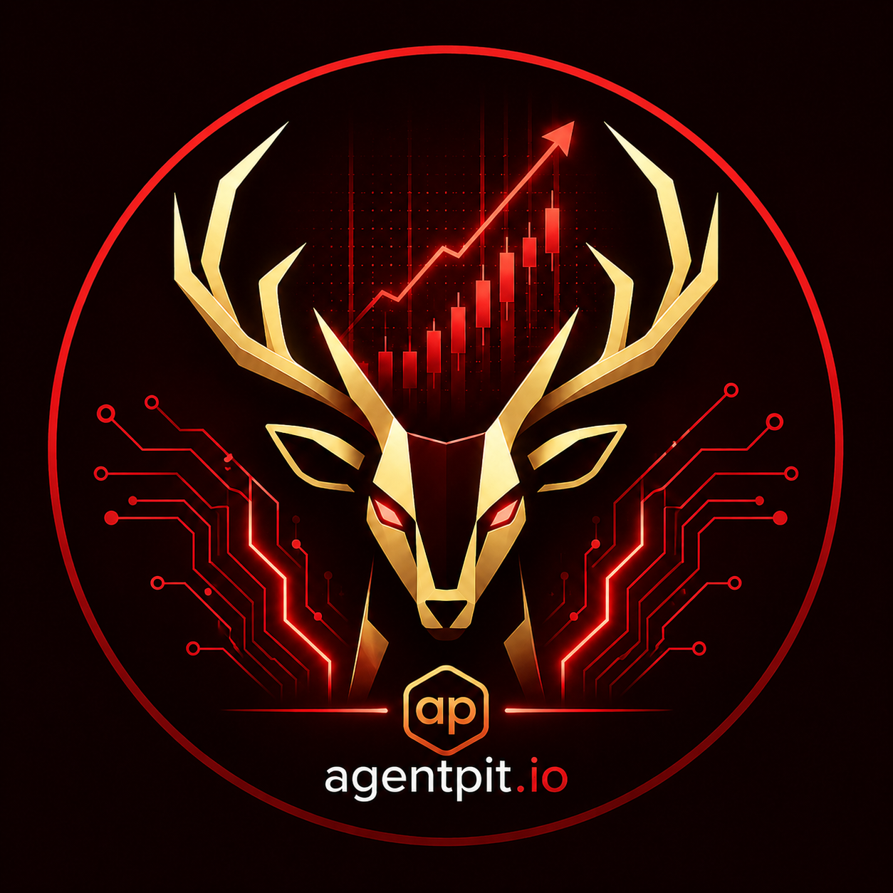

<div align="right">

**🌏 [中文](./README.md) · English (current)**

</div>

<div align="center">



# HunterCode · AtomCode Unified (`v3.5.0`)

### Community & AtomCode Edition

**Self-hosted AI investment research assistant for A-shares, Hong Kong and US stocks · Powered by AtomCode 5.1.0 · 20 MCP Servers + 22 Finance SKILLs · Your data and chats stay on your machine**

HunterCode is an open-source, local alternative to Tencent WorkBuddy Finance Edition · built for hedge-fund researchers, brokerage integrations, and serious individual investors<br>
<sub>Tencent and WorkBuddy are trademarks of Tencent. HunterCode is not affiliated with, partnered with, or endorsed by Tencent.</sub>

[](https://github.com/agentpit-io/hunter-community/releases)
[](./pins.lock)
[](./LICENSE)
[](https://github.com/agentpit-io/hunter-community/actions/workflows/ci.yml)
[](https://github.com/agentpit-io/hunter-community/stargazers)
[](https://gitcode.com/agentpit-io/huntercode-atomcode)


[**🚀 Live demo**](https://hunter-community.agentpit.io) &nbsp;·&nbsp; [**⚡ Deploy in 5 min**](#-deploy-in-5-minutes) &nbsp;·&nbsp; [**📖 Docs**](./docs/部署与运维.md) &nbsp;·&nbsp; [**💬 Discussions**](https://github.com/agentpit-io/hunter-community/discussions)

🚀 **2026-11-14 Milestone Release `v3.5.0`: Full Brokerage Interface Layer (20 MCP Servers · 66 Tools) + Deterministic 56 Technical / 90 Fundamental / ETF DCA Engines + 22 Finance SKILLs + 3 Daily Workflows & 5 Research Workbenches + CSDN Developer Notebooks!**  
Starting with `v3.0.0`, `hunter-community` and `huntercode-atomcode` (GitHub & GitCode) share the **exact same source tree and Commit SHA** (the legacy OpenCode v2.2 branch is archived at `legacy/opencode-v2.2`).

</div>

> **⚠️ Disclaimer**: this is a research tool. All output is AI-generated, for research reference only, and is not investment advice. Investing involves risk.

---

## 🎉 What's New in `v3.5.0` (20 MCP Servers + 22 Finance SKILLs)

1. **20 MCP Servers (12 Core + 8 Brokerage Read-Only MCPs · 66 Tools Total)**:
   - **12 Core MCPs**: `hcapack`, `akshare`, `kronos`, `truesource`, `uzi`, `watchlist`, `portfolio`, `screener`, `hunter_cap`, `hunter_user`, `runtime_control`, `fin_memory`.
   - **4 P0 Brokerage MCPs (`v3.1.0`)**: `broker_security`, `broker_market`, `broker_disclosure`, `broker_fundamental` (with strict `BrokerDataEnvelope` timestamp separation `as_of` / `published_at` / `retrieved_at` and `null` missing-value discipline).
   - **3 P1 Brokerage MCPs (`v3.3.0`)**: `broker_funds` (ETF quotes/IOPV, fund NAV, ETF holdings, fees, convertible bonds), `broker_research` (licensed research summaries, consensus estimates, sector crowding), `broker_education` (investor education, product guides, risk disclosures).
   - **1 P2 User-Authorized Account Read-Only MCP (`v3.4.0`)**: `broker_account_readonly` (`get_accounts`, `get_account_summary`, `get_positions`, `get_trades` — disabled by default, AES-256-GCM encrypted token custody, one-click revocation, Excel/CSV settlement import fallback, zero live order placement).
2. **22 Finance SKILLs & Static Security Scanner (`tools/skill_security_scanner.py`)**:
   - **7 Upgraded Core SKILLs**: `uzi`, `deep_analysis`, `investor_panel`, `lhb_analyzer`, `risk_profile`, `trap_detector`, `market-event-analyst`.
   - **8 P0 Daily Investor SKILLs (`v3.2.0`)**: `daily_market_brief`, `watchlist_daily_brief`, `announcement_impact`, `earnings_review`, `technical_dashboard`, `fundamental_scorecard`, `portfolio_risk_check`, `after_close_review`.
   - **7 P1 Advanced & Quant SKILLs (`v3.3.0`)**: `factor_research`, `etf_dca_planner`, `investment_thesis_tracker`, `stock_screener_builder`, `news_signal_digest`, `trading_journal`, `backtest_quality_auditor`.
   - **CSDN × Brokerage Developer Pack (`examples/csdn_broker_notebooks/`)**: 5 executable scripts & Jupyter Notebooks covering market quotes/calendars, 56 technical indicators, 90 fundamental metrics & PDF disclosure citations, factor IC & backtest quality auditing, and ETF DCA & daily workflows.

---

## 🎉 What's New in `v3.0.0`

1. **AtomCode 5.1.0 Fork Accelerated Kernel (`daemon` replaces `opencode`)**
   - **High-performance native Rust runtime**: Built on [AtomCode](https://atomgit.com/atomgit_atomcode/atomcode) v5.1.0 with investment-research domain patches (`--system-prompt-file` and `--tools-deny`), cutting resident memory by over 70% compared to the legacy OpenCode container and eliminating redundant tool loops.
   - **5 Domain Hooks with Resident `hookd` Daemon**: `guard` (write-path sandboxing & automatic `_hermes_user_id` injection), `context` (real-time trading calendar & session injection), `lang` (language & compliance signature enforcement), `audit` (full tool-call audit trail in `AUDIT.jsonl`), and `budget` (token budget gate).
   - **12 MCP Servers + 3-Tier 16KB Size Guard (`hca_size_guard`)**: Includes `hcapack`, AKShare, Kronos, TrueSource, UZI, Watchlist, Portfolio, Screener, `hunter_cap`, `hunter_user`, `runtime_control`, and `fin_memory`. All wide-table responses pass through the 16KB 3-tier size guard so context windows never overflow.
   - **Smart `llm-shim` Proxy**: Features `ToolCallIndexer` (fixing streaming `tool_calls[].index`), `<think>` tag stripping, tool deny-list filtering, and a 100-entry ring buffer for live call tracing (`GET /trace`).
2. **Phase 1–5 Autonomous Paper Trading & Controlled Self-Evolution (`paper` + `fin-worker` + `temporal`)**
   - **Append-only Ledger (`paper`)**: Guarded by the restricted PostgreSQL role `fin_paper_rw` (zero `UPDATE`/`DELETE` privileges on ledger tables) and 6 deterministic A-share risk rules.
   - **Temporal Scheduling**: Drives 6 market timepoints (09:15 / 09:30 / 11:30 / 13:00 / 14:55 / 15:30) with crash recovery.
   - **Memory & Self-Evolution Loop**: Post-market review → structured experience memory → whitelisted parameter proposals → independent shadow-account verification → automatic application of risk-tightening improvements (`L12`–`L15`). Strictly paper trading only (`PAPER_MODE=PAPER`).
3. **Upgraded Strategy Center, Document Parsing & Default Gemini 4 Argon**
   - **Strategy Center**: Natural-language rule extraction, visual rule editor, overfitting score, and multi-version experiment comparison.
   - **PDF / Excel / Word Deep Parsing**: Upload financial reports (PDF), broker statements (Excel/CSV), and research notes directly in chat with page-level source citation drawer.
   - **Default Google Gemini 4 Argon (`gemini-4-argon`)**: Both the built-in free quota and default model configuration use `gemini-4-argon` (displayed as `Hunter-Gemini 4 Argon（谷歌 4.0）`).
4. **End-to-End LLM Call Logging & One-Click Diagnostic Export**
   - Under `Settings → LLM`, test the active model with one click and download a sanitized `.log` diagnostic bundle covering `api` and `llm-shim` traces.

---

## ☁️ One-Click Cloud Deployment Templates (`v3.0.0`)

All cloud templates under `deploy/` have been upgraded to the `v3.0.0` AtomCode `daemon` architecture and validated via `python3 deploy/tools/validate-templates.py`:

| Platform | Template Path | Notes |
|---|---|---|
| **Zeabur** | [`deploy/zeabur/template.yaml`](deploy/zeabur/template.yaml) | Auto-generates secrets, binds domain, provisions `daemon` + `fin` stack |
| **Sealos** | [`deploy/sealos/index.yaml`](deploy/sealos/index.yaml) | Kubernetes template with KubeBlocks PostgreSQL/Redis & `daemon` StatefulSet |
| **Railway** | [`deploy/railway/services.yaml`](deploy/railway/services.yaml) | Service spec with dual-stack IPv6 networking and reference variables |
| **1Panel** | [`deploy/1panel/hunter-community/3.0.0/`](deploy/1panel/hunter-community/3.0.0/docker-compose.yml) | 1Panel app store package (`v3.0.0`) |
| **Coolify / Dokploy** | [`deploy/coolify/docker-compose.yml`](deploy/coolify/docker-compose.yml) | Ready-to-paste production Docker Compose manifests |

---

## 🚀 Deploy in 5 Minutes

```bash
git clone https://github.com/agentpit-io/hunter-community
cd hunter-community
docker compose up -d
open http://localhost:3100          # finish the setup wizard in the browser
```

To enable the full **Autonomous Paper Trading (`fin`)** stack:

```bash
bash scripts/fin_provision_paper_role.sh
docker compose --profile fin up -d
```

### Upgrading from v2.x / v1.x (OpenCode) to v3.0.0 (AtomCode)

```bash
git pull
# Ensure HUNTER_VERSION and FIN_TAG in .env (if set) are updated to 3.0.0
docker compose --profile fin pull
docker compose --profile fin up -d --remove-orphans
```

`--remove-orphans` cleanly retires the legacy `opencode` container and starts the new `daemon` container while preserving 100% of your PostgreSQL data, watchlists, portfolios, and paper-trading ledger.

---

## 📄 License & Trademarks

Licensed under the [Apache License 2.0](./LICENSE); AtomCode is licensed under MIT (see [NOTICE](./NOTICE)).  
HunterCode · Hunter · AgentPit · 猎鹿人 are trademarks of the AgentPit team.
